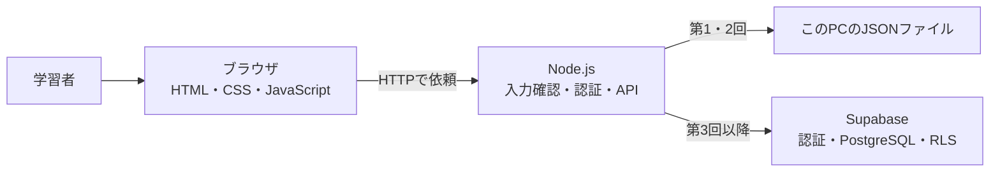

# 技術構成と費用

[教材の入口](../README.md)

料金・サービス情報の確認日：**2026年10月25日（日本時間）**。授業の前にリンク先を再確認してください。無料枠は将来の無償利用を保証するものではありません。

## 採用構成

HTTPはWeb上の依頼と応答のルール、JSONは項目名と値を組にしたデータの書式です。PostgreSQLはDBのソフトウェア、RLSは「どの利用者がどの行を扱えるか」をDB側で確認する仕組みです。

画面とAPIを同じNode.jsサーバーから配信します。別々のホスティング先を用意しないため、通信先URLやCORS（別サイトへの通信を許可する設定）を初回に学ぶ必要がありません。役割はフォルダで分け、コードを追えるようにしています。

## 選択肢と判断

| 構成 | 費用・準備 | 授業での位置づけ |
| --- | --- | --- |
| ローカルNode.js＋JSON | この教材のソフトウェアに従量料金なし。Node.jsのみ必要 | 第1・2回。外部登録なしで3つの役割を体験 |
| ローカルNode.js＋Supabase Free | Supabaseアカウントとネット接続が必要 | 第3回の推奨。実際のDBと認証を学ぶ |
| Cloud Run＋Supabase | Google Cloudの請求先・権限設定が必要。無料枠超過や関連サービスは課金対象になり得る | 第5回の必須デプロイ実習 |
| ブラウザからSupabaseへ直接接続 | 自作バックエンドを省ける。RLSは必須 | 比較対象。今回はサーバーの役割も学ぶため採用しない |

ReactやNext.jsを覚える前に、HTML（画面の構造）、CSS（見た目）、JavaScript（動き）を少量ずつ読みます。バックエンドも同じJavaScriptなので、言語を増やしません。Node.jsは24.x LTSを検証対象とします。[Node.jsリリース情報](https://nodejs.org/en/about/previous-releases)

## Supabaseは無料で始められるか

確認時点のFreeプランは月額$0、DB 500 MB、月間アクティブユーザー50,000、アクティブなプロジェクト2つまでです。1週間使わないとプロジェクトが一時停止する場合があるため、講師は授業前に起動を確認します。小規模な授業には十分と判断しましたが、これはこの教材の利用量を前提とした判断です。[公式料金表](https://supabase.com/pricing)

受講者ごとのFreeプロジェクトを推奨します。全員に管理者権限を共有する運用は避け、共有プロジェクトを使う場合は講師が管理し、アプリ用の練習ユーザーだけを配ります。

## Cloud Runは従量課金か

はい。使ったCPU・メモリ・リクエストなどに応じて料金が決まり、無料枠もあります。課金方式とリージョン（設置地域）により条件が異なります。無料枠は請求先アカウント単位で集計されるため、他のプロジェクトの利用も影響します。[Cloud Run料金](https://cloud.google.com/run/pricing)

ソースからのデプロイ（クラウドへ配置し動かすこと）はCloud BuildやArtifact Registryも使い、それぞれの費用が別途生じる場合があります。登録・権限・課金の理解を初回に詰め込まず、まず自分のPCで完成させます。[Node.js公式クイックスタート](https://cloud.google.com/run/docs/quickstarts/build-and-deploy/deploy-nodejs-service)

第5回では最小インスタンス0・最大1を設定します。これらは費用を抑える設定であり、請求額の上限ではありません。「通知のみ」の予算アラートも支出を停止しません。組織で使う場合は管理者と費用制御を確認します。[予算とアラート](https://cloud.google.com/billing/docs/how-to/budgets)

## 公開後の構成とブラウザ保存

[第5回の構成図](lessons/05-deploy.md)に、ブラウザ・Cloud Run・Supabase Auth・DB API・PostgreSQLの通信経路を示しています。画面のコードはCloud Runが配り、ブラウザが実行します。タスクの正本はDB、画面に読み込んだコピーとトークンはメモリです。localStorageなどは本体では使っていません。[役割と保存の比較](roles-and-storage.md)で一般的な用途と今回の実装を分けています。

## データと認証の設計

1. Supabase Authがメールアドレスとパスワードを確認し、本人であることを示すアクセストークンを発行。
2. 画面はタスク操作のたびにトークンをNode.jsへ送信。
3. Node.jsはSupabaseへ本人確認を依頼し、利用者のトークン付きでDB APIを呼ぶ。
4. DBはRLSで `auth.uid() = user_id` を確認し、本人の行だけを許可。

アプリに設定するのはpublishableキーで、RLSを回避するsecret／service_roleキーは使いません。キーはアプリを、トークンは利用者を識別します。publishableキー単体は本人認証の代わりになりません。[APIキー](https://supabase.com/docs/guides/getting-started/api-keys)、[RLS](https://supabase.com/docs/guides/database/postgres/row-level-security)

## 学習用としての制約

- ローカルJSON版は1プロセス・1利用者向け。公開用の保存先ではありません。DB版への自動移行はしません。
- ローカルは最大200件、DB版の一覧は最新200件を表示します。大量データのページ分割は発展課題です。
- JavaScriptは文字数をUTF-16単位で数えます。絵文字などは見た目の1文字が2以上になる場合があります。DBの文字数判定と完全には一致しませんが、サーバーは同じか厳しい制限になります。
- ログインの自動更新・会員登録画面は実装しません。再読み込みやトークン期限切れでは再ログインします。
- ログアウトはブラウザのトークン消去のみ。トークンを即時無効化する実装ではありません。
- 一般公開前には、濫用対策、監視、バックアップ、障害対応、認証運用などを別途設計します。授業での完成と本番運用の準備完了は別の判定です。
