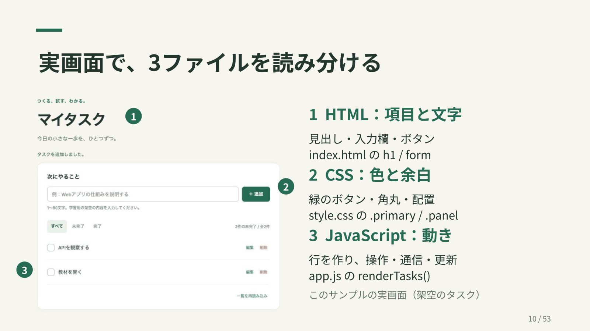
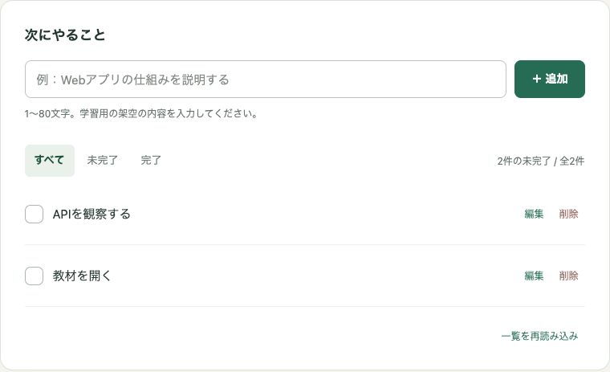
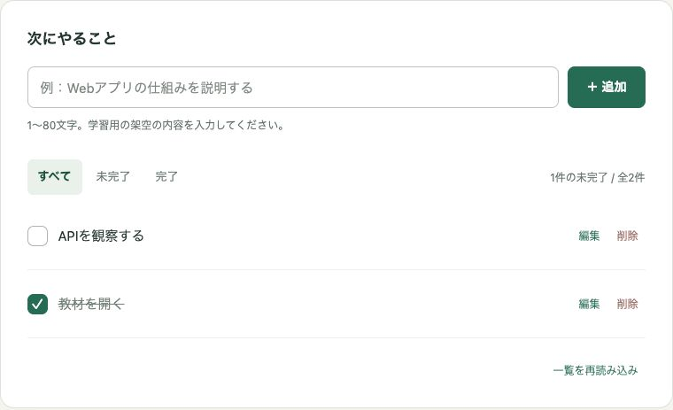
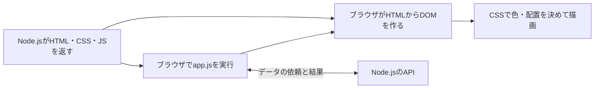
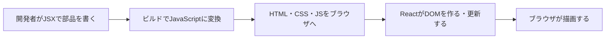
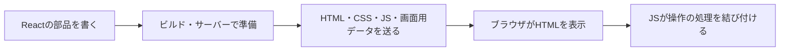

# ブラウザ・実画面・React／Next.jsのつながり

[第1回教材](lessons/01-overview.md) / [役割と保存先](roles-and-storage.md) / [保存の実験](exercises/01-browser-storage.md)

このサンプルは **HTML・CSS・JavaScriptとNode.js** で作っています。React／Next.jsは使っていません。まず3つのファイルと画面を対応させ、その後にReact／Next.jsを使う場合の違いを5分で見ます。比較部分は読む教材で、追加インストールや書き換えは不要です。

## 1. ブラウザとは

Chrome、Edge、Safari、Firefoxなど、Webの内容を受け取り、画面を表示して操作できるようにするアプリです。検索サービスはブラウザの中で開けるサービスの1つです。アドレス欄にURLを入れると、その場所へ内容を要求します。今回の `http://localhost:3000` は、自分のPCで動くNode.jsへの入口です。

| ブラウザでできること | マイタスクで見る例 |
| --- | --- |
| HTMLとCSSから画面を描く | 見出し、入力欄、ボタンの配置や色 |
| JavaScriptを実行する | 件数の計算、クリックへの反応、一覧の更新 |
| サーバーと通信する | 追加・完了の依頼と、結果の受け取り |
| 端末内にデータを持つ | 表示中のタスクのコピー、一時的な入力、保存実験のメモ |
| 画像・音声などを扱う | 一般的な機能。本サンプルでは画像投稿や音声入力は実装しない |

ブラウザの中で動くコードは、サーバーやPCのすべてのファイルを自由に操作できるわけではありません。必要なデータはAPIなどの決められた窓口へ依頼します。[MDN：ブラウザ](https://developer.mozilla.org/en-US/docs/Glossary/Browser)

## 2. 実画面から3つのファイルを探す

前提：[起動手順](../README.md)でローカル練習モードを開きます。「教材を開く」「APIを観察する」の2件を追加すると、次の撮影例と同じ状態になります。画像はこのリポジトリの実アプリで、架空のデータだけを使っています。

[元の実画面を大きく見る](images/app-before.jpg)。番号は説明のためにスライド上で加えています。

| 画面で指すところ | 担当ファイル・探す文字 | 何を決めるか |
| --- | --- | --- |
| 上の「マイタスク」 | `index.html` の `<h1>マイタスク</h1>` | HTMLが見出しという項目と文字を用意する |
| 入力欄・「＋ 追加」 | `index.html` の `task-form`、`input`、`button` | HTMLが入力と操作の部品を用意する |
| ボタンの緑、カードの角、余白 | `style.css` の `--accent`、`.primary`、`.panel` | CSSが見た目を指定する |
| 下に並ぶタスクの行 | `app.js` の `renderTasks()` と `document.createElement` | JavaScriptが取得したデータから要素を追加する |
| 左のチェックを押した後の変化 | `app.js` の `change`、`PATCH`、`renderTasks()` | JavaScriptが操作を受け、保存を依頼し、結果を反映する |

同じボタンにも3つが協力しています。HTMLがボタンを用意し、CSSが色を付け、JavaScriptが送信を処理します。見える文字すべてが `index.html` に書いてあるわけではありません。タスク名や件数は `app.js` が更新します。

### 完了にしたとき、何が変わる？

操作前：2件とも未完了です。

操作後：「教材を開く」にチェックを入れると、未完了が1件になり、取り消し線が付きます。

1. ブラウザがチェックの操作を受け、JavaScriptの処理が動く。
2. `PATCH /api/tasks/ID` で `done: true` をNode.jsへ送る。PATCHは一部の値を変更する依頼。
3. Node.jsが確認し、練習用ファイルへ保存する。第3回以降はDBへ保存する。
4. 成功の応答を受け、JavaScriptがタスクのコピーと画面を更新する。
5. 完了の行に付いた `done` という目印に、CSSの `.done .task-label` が取り消し線を付ける。

**期待する結果**：チェック・件数・取り消し線が変わり、再読み込み後も完了のままです。保存に失敗した場合、チェックを元に戻してエラーを表示します。つまずいたらサーバーの起動状態と画面のメッセージを確認します。第2回ではNetwork（通信の記録）で保存の要求を見ます。

## 3. ファイルがブラウザの画面になる流れ

**DOM**は、ブラウザが扱う「見出し・ボタンなどの要素の構造」です。画面を描く処理をレンダリングと呼びます。

HTMLの `link` と `script` がCSS・JSの場所を知らせます。このアプリは、最初のHTMLに画面の枠と空の一覧を持ち、JavaScriptがAPIから読み取ったタスクをDOMへ追加します。ブラウザは変わった内容を描き直します。実際には読み込みと処理が重なる部分もあります。[MDN：Webサイトが読み込まれる流れ](https://developer.mozilla.org/en-US/docs/Learn_web_development/Getting_started/Web_standards/How_browsers_load_websites)

## 4. Reactを使うと何が変わる？（比較）

**React**は、画面を「コンポーネント」という部品に分けて作るライブラリ（再利用する機能の集まり）です。**JSX**は、JavaScriptの中にHTMLに似た形で画面を書く記法です。

| このサンプル | Reactで作る場合の例 |
| --- | --- |
| `document.createElement('li')` で行を作る | `TaskRow` という部品で行を表す |
| `renderTasks()` で一覧を更新する | データの変化に合わせてReactが必要なDOMの更新を行う |
| `index.html`・`style.css`・`app.js` をそのまま配る | JSXなどをビルド（配信・実行用に準備する処理）して配る |

これは主にブラウザ側で画面を作る例です。**ブラウザがJSXをそのまま理解するわけではありません**。JSXの変換と、HTMLを生成する処理は別です。Reactにはサーバー側でHTMLを生成する使い方もあります。[React：JSX](https://react.dev/learn/writing-markup-with-jsx)、[React：描画とDOMへの反映](https://react.dev/learn/render-and-commit)

## 5. Next.jsではサーバーも画面づくりに参加する（比較）

**Next.js**はReactを土台に、ページの切り替えやサーバー処理などをまとめたフレームワーク（開発の仕組みと約束事のセット）です。以下はApp Routerを使う場合の最初の表示の概要です。

サーバーで動く **Server Component** と、ブラウザで操作を扱える **Client Component** を分けます。最初のHTMLはビルド時または要求時などに準備されます。既にあるHTMLへ操作の処理を結び付けることを **ハイドレーション** と呼びます。Client Componentも、最初のHTMLを作る際はサーバー側で処理されることがあります。画面用データにはReactの部品構成を伝えるRSC Payloadも含まれます。

要点は「書くのはReactの部品でも、ブラウザは届いたHTML・CSS・JavaScriptなどを使う」です。ここでは比較だけを行い、この教材のCloud Runでは引き続き既存のNode.jsサーバーを動かします。[Next.js：Server and Client Components](https://nextjs.org/docs/app/getting-started/server-and-client-components)

## 6. ブラウザにある「データ」と「セッション」

ここでのデータは、文字・数字・真偽値など、アプリが扱う値です。タスク名だけでなく、`done: true`、検索文字、選んだ表示条件、ログインを証明するトークンもデータです。

| 例 | どこに持つ？ | 再読み込みすると？ |
| --- | --- | --- |
| 読み込み済みタスクのコピー | ブラウザのメモリ | コピーを読み直す。正本はファイル／DBに残る |
| 選択中の「未完了」、第4回の検索文字 | このアプリではメモリ | 初期状態へ戻る |
| 保存実験の一時メモ | sessionStorage | 同じタブでは残る。通常タブを閉じると終了 |
| 保存実験の表示設定メモ | localStorage | 通常は残る。別端末への同期はしない |
| Supabase版のログイントークン | このアプリではメモリだけ | 失われるので再ログインする |

**ログインのセッション**は、本人確認した利用者として継続して扱う状態や期間のことです。状態をどう識別するか、どこに証明を置くかは設計次第で、Cookieを使う方式や、トークンを送る方式などがあります。**sessionStorageは保存機能の名前で、ログイン機能そのものではありません**。保存しただけでログイン状態が成立するわけではありません。

このサンプルでは、パスワードを使って取得したトークンをメモリに持ち、APIに送ります。タスクはDBに残るため、再ログインすれば再び読めます。「ログアウト」はこの画面のトークンを消すだけで、発行済みトークンを即時失効させる処理は含みません。パスワードをlocalStorageへ保存する演習は行いません。

localStorageとsessionStorageは、通信方式・ホスト名・ポートを組にした**オリジン**で区切られます。`localhost` と公開URLは別の領域です。Cookie、IndexedDB、削除される条件は[保存領域の比較表](roles-and-storage.md)で確認してください。ブラウザには配信ファイルなどを再利用する**キャッシュ**もありますが、それをタスクの正本として扱う設計ではありません。[MDN：Web Storage](https://developer.mozilla.org/en-US/docs/Web/API/Web_Storage_API)、[MDN：Cookie](https://developer.mozilla.org/en-US/docs/Web/HTTP/Guides/Cookies)

## 確認してみよう

1. 見出しの文字、ボタンの色、完了後の件数は、それぞれどのファイルを見る？
2. `index.html` の空の一覧に、タスクの行を追加するのは何？
3. ReactのJSXを、ブラウザがそのまま実行する？
4. sessionStorageに文字を保存すれば、ログインしたことになる？

答え：1はHTML・CSS・JavaScript、2は `app.js`、3はそのまま実行せずビルドでJSへ変換、4はならず本人確認と権限確認が別途必要です。
