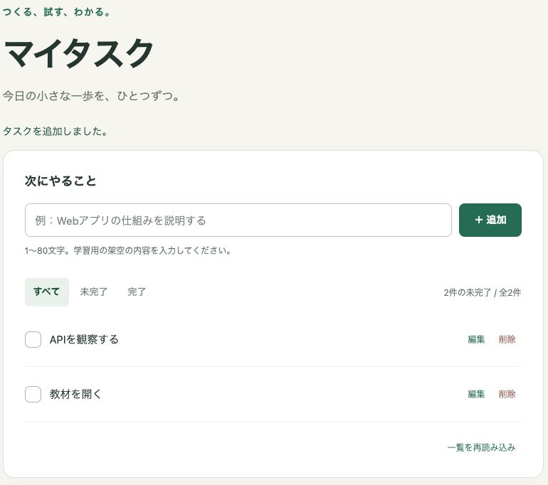

# 第1回：小さなアプリを動かして、3つの役割を知る

[カリキュラム](../curriculum.md) / [演習1](../exercises/01-first-app.md)

## 今日の目標と準備

目標は「入力して保存する動きを体験し、どのファイルが画面を作るか説明できる」です。[事前準備](../setup.md)を終え、教材フォルダをエディターで開きます。

90分の流れ：導入・ブラウザ5、役割10、起動・基本操作15、実画面と3ファイル・画面変更20、React／Next.js比較5、サーバー保存10、ブラウザ保存15、振り返り10分。

## ブラウザはWebアプリを動かす入口

ブラウザはChromeやSafariなど、Webの内容を受け取って画面を表示し、操作できるようにするアプリです。JavaScriptの実行、サーバーとの通信、端末内のデータ保存もできます。[実画面・ブラウザ・React／Next.jsの補足](../browser-and-frameworks.md)を使い、見える画面とコードを対応させます。

## アプリは「入力・処理・保存・表示」で考える

紙のメモ帳なら、書いて、保存して、後で読むことができます。マイタスクも同じ目的を持ちますが、仕事を3つに分けます。

| 役割 | 平易な説明 | このアプリの例 |
| --- | --- | --- |
| フロントエンド | 人が見て操作する画面 | 入力欄、追加ボタン、タスク一覧 |
| バックエンド | 画面から依頼を受け、ルールを確認して処理する部分 | 空の名前を断る、保存先へ書き込む |
| DB（データベース） | 情報を整理して、後で使えるように保存する場所 | 第3回のSupabase。今回はJSONファイルで保存を体験 |

「追加」を押すと画面はサーバーへ依頼します。サーバーとは、他のプログラムからの依頼を待って処理するプログラムやコンピューターです。今回のサーバーは自分のPC上のNode.jsです。画面と同じPCでも、役割は異なります。

## ブラウザも計算・保存ができる

フロントは表示だけでなく、検索や端末内の保存もできます。[役割と保存の比較表](../roles-and-storage.md)を使い、画面の表示設定・サーバーの入力確認・DBの共有データを分けます。タスクの保存先は今回はサーバーのファイルです。[ブラウザ保存の実験](../exercises/01-browser-storage.md)では、別の架空のメモを保存し、再読み込みで消えるもの／残るものを比べます。

## 画面を作る3つのファイル

- **HTML**：見出し、入力欄、ボタンなどの構造。`app/public/index.html`。
- **CSS**：色・大きさ・余白などの見た目。`app/public/style.css`。
- **JavaScript**：クリックに反応し、通信や画面更新をする処理。`app/public/app.js`。

見出しはHTML、緑のボタンはCSS、チェック後の件数更新はJavaScriptを見ます。同じボタンにも3つが協力しています。タスクの行は `app.js` の `renderTasks()` が作り、完了後の取り消し線はCSSが付けます。[操作前後の画像と対応表](../browser-and-frameworks.md)で確認しましょう。

例：HTMLの `<h1>マイタスク</h1>` は大きな見出しです。タグと呼ぶ `<h1>` と `</h1>` の間に表示する文字があります。初回はタグ自体を消さず、間の文字だけを変えてみます。

## React／Next.jsを使う場合との比較（5分）

本サンプルはReact／Next.jsを使っていません。ブラウザはHTMLからDOM（要素の構造）を作り、CSSで見た目を決め、JavaScriptでその構造を更新できます。ReactではJSXという記法をJavaScriptへ変換し、ReactがDOMを更新します。Next.jsではサーバーで初期HTMLを用意する処理も加わります。[比較図](../browser-and-frameworks.md)を読み、ブラウザへ届くものと実行場所を区別します。追加実装はしません。

## 演習

[演習1](../exercises/01-first-app.md)に沿って、起動、基本操作、見出しと色の変更、再起動後の保存を確認します。変更前のファイルを複製しておくと、失敗しても戻せます。

## 理解を確かめる

1. タスクを追加したとき、画面だけが仕事をしていますか。
2. 色を変えるときは、HTML・CSS・JavaScriptのどれを開きますか。
3. このアプリのタスクと、保存実験のメモはそれぞれどこにありますか。
4. ReactのJSXと、ブラウザへ届くものは同じですか。
5. ログインのセッションとsessionStorageは同じ意味ですか。
6. ブラウザの値を利用者が変えられるとき、権限はどこで確かめるべきですか。

説明例：「画面が入力を受け、Node.jsが内容を確認して、このPCのファイルに保存する。色はCSSで変える」。解答例は[こちら](../solutions/01-03.md)。

任意の復習：アプリをもう一度起動し、3つの役割を紙に描いてください。次回は、画面とサーバーのやり取りを実際に見ます。
