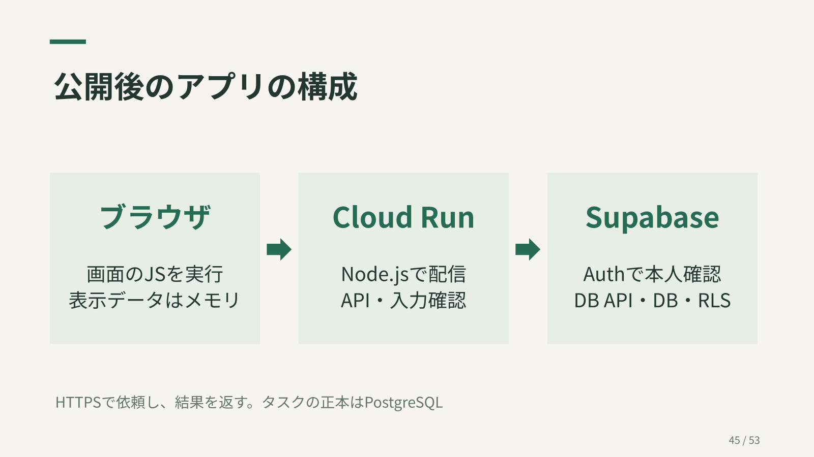
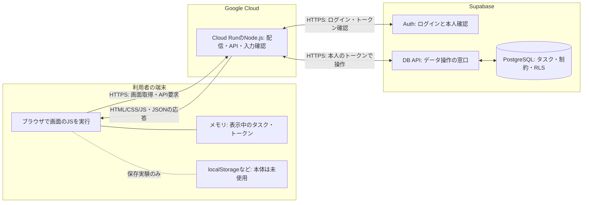

# 第5回：デプロイし、公開後の全体構成を説明する

[カリキュラム](../curriculum.md) / [演習5](../exercises/05-deploy.md) / [Cloud Run操作手順](../cloud-run.md)

目標は「学習用のURLでアプリを開き、どこでコードが動き、どこにデータが残るか説明する」です。第4回の検索とSupabase接続が動作すること、[クラウドの事前準備](../cloud-run.md)を終えていることが前提です。

90分の流れ：構成10、公開内容の確認10、配置とURL設定25、公開と動作確認20、再配置と保存確認15、発表と片付け10分。クラウドの待ち時間で終わらない場合は、確認を省略せず補講へ引き継ぎます。

## デプロイすると変わること

デプロイは、アプリを動かす環境へ配置することです。自分のPCで動かしていたNode.jsをCloud Runで動かします。Cloud Runはアプリと実行環境をまとめた「コンテナ」を動かすサービスです。SupabaseのDBは同じ学習用プロジェクトを引き続き使います。

HTML/CSS/JavaScriptはCloud Runから配信されますが、**画面のJavaScriptが実行される場所は利用者のブラウザ**です。サーバーのJavaScriptはCloud RunのNode.jsで実行されます。

講義スライドの概要図です。下の詳細図では、ブラウザの保存領域とSupabase内の担当も分けています。

HTTPSは暗号化されたWeb通信です。この構成では画面と `/api/tasks` が同じCloud RunのURLです。ブラウザからSupabaseへ直接通信する実装ではありません。Supabase AuthへのログインとDBへの操作はNode.jsが仲介します。

## 画面を開く流れと、タスクを保存する流れ

| 操作 | 順序 |
| --- | --- |
| URLを開く | ブラウザがCloud Runへ要求 → Node.jsがHTML/CSS/JSを返す → ブラウザが画面を作る |
| ログイン | ブラウザがメール・パスワードを送る → Node.jsがSupabase Authへ依頼 → トークンをブラウザのメモリに保持 |
| タスクを追加 | ブラウザが入力とトークンを送る → Node.jsが本人と入力を確認 → DB APIとRLSで本人の行を保存 → 結果で画面を更新 |
| 再読み込み | メモリのトークンは消える → 再ログイン → DBから本人のタスクを読み直す |

## 保存先を間違えない

ブラウザのlocalStorageはその端末・オリジンの保存領域です。Cloud Runを公開しても、localhostの保存値が公開URLへ移動することはありません。DBに保存したタスクは、同じユーザーで別のブラウザからログインすると取得できます。

Cloud Runの通常のローカルファイルはインスタンス終了時に残りません。この教材では `APP_MODE=supabase` を使い、タスクをDBへ保存します。DBの削除・変更を伴わないコードの再配置で、タスクは消えません。[Cloud Runのファイルシステム](https://cloud.google.com/run/docs/container-contract)

## 「URLを公開」と「データを公開」は分けて考える

Cloud RunのIAMはサービスを呼べる人の管理です。学習用のログイン画面を公開しても、タスクの操作にはSupabaseのログインとRLSが必要です。画面が開くことだけで合格にせず、未ログインの401とA/Bのデータ分離を確認します。

GitHubへのpushはコードの共有です。この教材には自動デプロイ設定がないため、pushだけでCloud Runに変更は反映されません。今回は `gcloud run deploy --source .` で手元のコードを配置します。

最後に構成図を使い、「画面のJS」「サーバーのJS」「タスクの正本」「ブラウザ内だけの状態」を指して説明します。[役割の比較表](../roles-and-storage.md)で担当を確認してください。
